# 👑 Princess Escape

<p align="center">
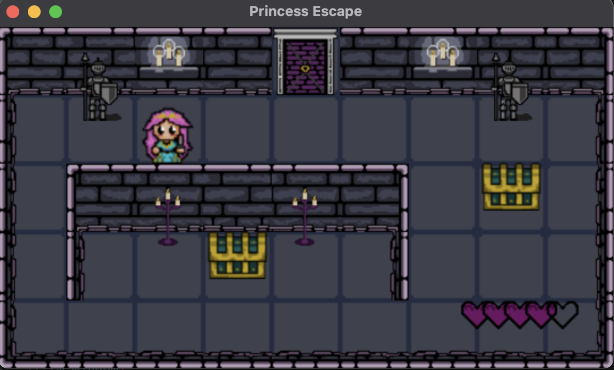
</p>

> *A handcrafted 2D adventure game built in modern C++ with SDL3.*

---

# 📖 Story

## 📖 Story

One night, the princess awakens deep beneath an ancient castle with no memory of who she is or how she got there.

Its endless corridors are filled with abandoned chambers, hidden treasures, forgotten mechanisms, and strange creatures that attack her on sight, determined to keep her trapped.

The castle itself feels alive, constantly testing her resolve and drawing her deeper into its labyrinth.

To escape, she must explore every corner, collect useful items, unlock hidden passages, survive deadly encounters, and slowly recover fragments of her lost memories, piecing together the events that led her into this nightmare.

Every key found, every potion consumed, and every treasure chest opened could mean the difference between freedom... and becoming a forgotten soul, condemned to wander within the castle for eternity, with no memory of who she once was.

Little does she know that escaping the castle is only the beginning of a much greater journey... Beyond its walls await three mysterious realms, each bringing her closer to the truth behind her forgotten past.

---

# 🎮 Gameplay

Princess Escape is a top-down exploration game inspired by classic adventure games.

The player explores interconnected rooms, searches for hidden treasures, solves environmental puzzles, manages an inventory, and fights to survive while progressing deeper into the castle.

Throughout the adventure, the player will:

- 🗝️ Find keys to unlock new areas
- 📦 Discover hidden treasure chests
- ❤️ Collect potions to restore health
- 👾 Battle dangerous enemies
- 🚪 Unlock mysterious doors
- 🧩 Solve puzzles
- 🌍 Travel through different worlds, each hiding new dangers and secrets
- 💬 Talk to mysterious characters who may help—or deceive—you
- 🏰 Find a way to escape the cursed castle
<br>


---

# 🎨 Handmade Pixel Art

One of the goals of this project was to create **every visual asset from scratch**.

Every sprite, animation and object was **hand-drawn pixel by pixel using Piskel**.

No external sprite packs or asset libraries were used.

This includes:

- The Princess
- Enemies
- Treasure Chests
- Doors
- Potions
- Castle Decorations
- Environment Tiles
- User Interface Icons

## Sprite Showcase

<h3>👸 Princess</h3>
<p align="center">
  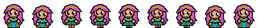
  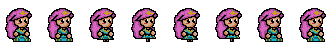
  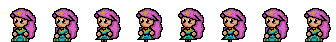
  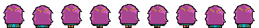
  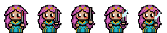
  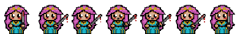
  
</p>

<h3>☠️ Ennemy</h3>
<p align="center">
  
  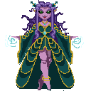
</p>

<h3>📦 Chest</h3>
<p align="center">
  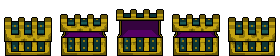
</p>

<h3>🏰 Castle Decoration</h3>
<p align="center">
  
</p>

<h3>🖼️ Walls</h3>
<p align="center">
  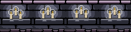
</p>

<h3>🚪 Door</h3>
<p align="center">
  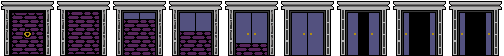
</p>

<!-- <h3>☠️ Ennemy</h3>
<p align="center">
  
</p> -->


---

# 🏗️ Built From Scratch

Princess Escape was developed entirely in **Modern C++** using **SDL3**.

The project focuses on building a complete game architecture without relying on game engines.

Main systems include:

- Animation System
- Collision Detection
- Inventory Management
- Interactable Objects
- Enemy System
- Health System
- Resource Manager
- Tile Map Rendering
- UI System

---

# 💻 Code & Architecture

Princess Escape is built from scratch in **C++20 and SDL3**, without relying on an existing game engine.

The project follows an object-oriented architecture, with separate systems for rendering, player movement, animation, collision detection, inventory management, and world interactions.

## 📂 Project Structure

```text
src/
├── main.cpp
│
├── Game/
│   ├── Game.cpp
│   ├── Events.cpp
│   ├── Visual.cpp
│   ├── VisualChange.cpp
│   └── Utils/
│       ├── Init.cpp
│       ├── Move.cpp
│       ├── Draw.cpp
│       ├── LoadImg.cpp
│       └── key.cpp
│
├── Player/
│   ├── Player.cpp
│   └── Inventory.cpp
│
├── Map/
│   ├── Map.cpp
│   ├── Wall.cpp
│   ├── Decor/
│   │   └── Decor.cpp
│   └── Interactable/
│       ├── Interactable.cpp
│       ├── Chest.cpp
│       ├── Door.cpp
│       └── Enemy.cpp
│
├── UtilsObject/
│   ├── Animation.cpp
│   ├── Collision.cpp
│   └── Textures.cpp
│
└── Ui/
    ├── Ui.cpp
    └── DrawInventory.cpp
```

## ⚙️ Game Loop

The main game loop handles events, updates game logic, and renders each frame.

Movement and animations use **delta time** to remain consistent across different frame rates.

```cpp
void Game::run()
{
    Uint64 lastTime = SDL_GetTicks();

    while (m_running)
    {
        const Uint64 currentTime = SDL_GetTicks();

        m_deltaTime =
            static_cast<double>(currentTime - lastTime) / 1000.0;

        lastTime = currentTime;

        if (m_deltaTime > 0.05)
            m_deltaTime = 0.05;

        handleEvent();
        VisualChange();
        render();
    }
}
```

## 🎞️ Custom Animation System

A reusable animation system handles frame transitions for the player, environmental objects, and interactive elements.

Animations can either:
- Loop continuously (walking, moving decorations).
- Play once (opening doors, taking damage).
- Reset when an object's state changes.

```cpp
bool Animation::moveOnLoop(double deltaTime)
{
    if (m_frameDuration <= 0 || m_nbFrame <= 0)
        return false;

    m_elapsedTime += deltaTime;
    bool frameChanged = false;

    while (m_elapsedTime >= m_frameDuration)
    {
        m_elapsedTime -= m_frameDuration;
        m_currentFrame =
            (m_currentFrame + 1) % m_nbFrame;

        frameChanged = true;
    }
    return frameChanged;
}
```

## 🧱 Collision Detection

The game uses a custom **Axis-Aligned Bounding Box (AABB)** collision system.

Collision boxes are defined independently from sprite dimensions, allowing more precise interactions with walls, decorations, chests, and doors.

Player movement also checks the X and Y axes separately, allowing smooth sliding along obstacles.

## 🗺️ Tile-Based Map System

Castle levels are loaded from text files.

Each character represents a specific element, such as a wall, floor tile, chest, door, or decorative object.

The map loader automatically creates objects and their corresponding collision boxes.

This makes it possible to create and modify levels without changing the game logic.

## 🎒 Inventory & Interactions

The inventory uses an `std::unordered_map<Item, int>` to store items and their quantities.

Interactive objects have their own states and behaviors.

For example:
- Chests transition from closed to opened and reward the player with loot.
- Doors require keys and trigger level transitions.
- Potions restore player health.
- Inventory navigation is managed through a grid-based selection system.

## 👾 Enemy AI (Work in Progress)

The enemy system uses a **finite state machine** to manage different behaviors:

`Idle → Patrol → Chase → Attack`

Additional states handle damage and death.

Enemy behavior includes distance-based player detection, directional movement, and wall collision checks.

The system is still being integrated into the gameplay.

## 🧠 Technical Highlights

Through this project, I have been exploring:

- Object-oriented programming in C++.
- Game architecture and separation of responsibilities.
- SDL3 rendering and texture management.
- Frame-rate-independent movement.
- Finite state machines.
- Custom sprite sheet animation.
- AABB collision detection.
- File-based level loading.
- Dynamic collections using STL containers.

All these systems are implemented directly in C++, without relying on a game engine.

---

# 📸 Screenshots

## Exploring the Castle

<p align="center">
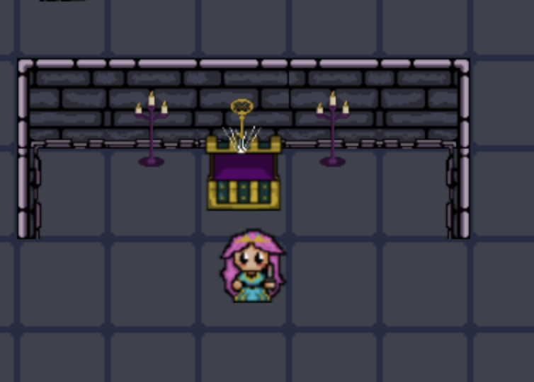
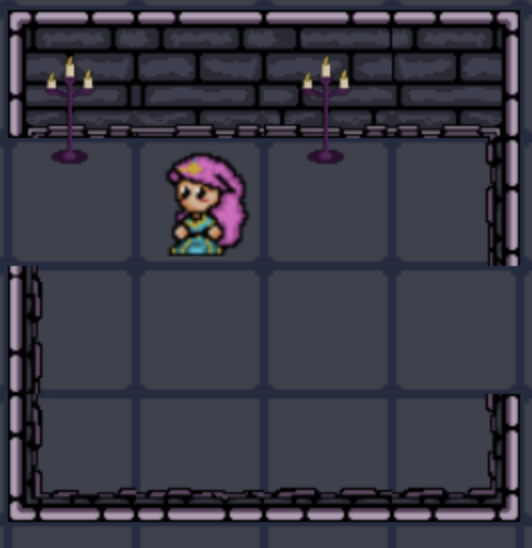
</p>

## Inventory

<p align="center">
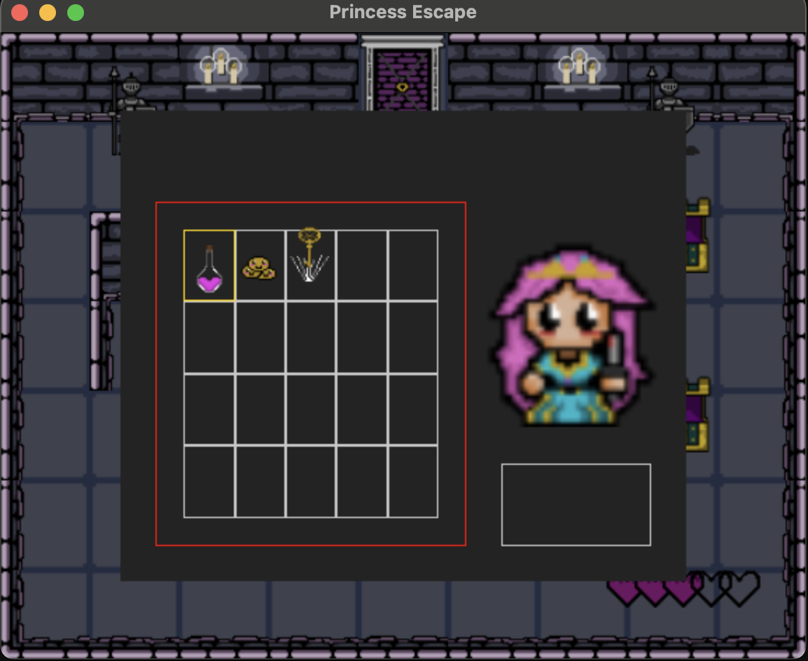
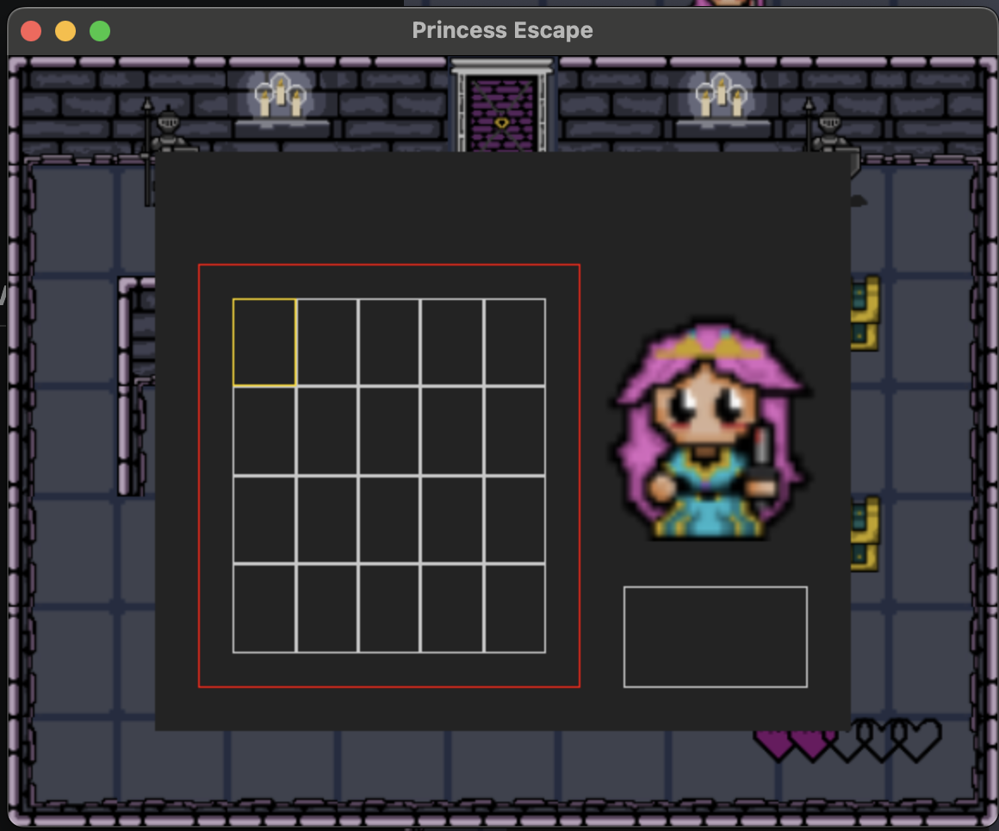
</p>

<!-- ## Treasure Room


---

## Enemy Encounter

 -->

---

# 🛠 Technologies

- C++20
- SDL3
- SDL3_image
- SDL3_ttf
- CMake

---

# 🌱 Future Plans

Princess Escape is still under development.

Planned features include:

- More enemy types
- Boss battles
- New castle areas
- Sound effects & music
- Save system
- NPC interactions
- More puzzles
- Controller support

---

# ❤️ A Personal Project

Princess Escape is much more than a programming exercise.

It is a personal project where I combine software engineering, game development and pixel art.

From the game architecture to every single sprite, everything has been created by myself as a way to improve my skills in C++, game design and software architecture.

I hope you enjoy exploring the castle as much as I enjoyed building it.
